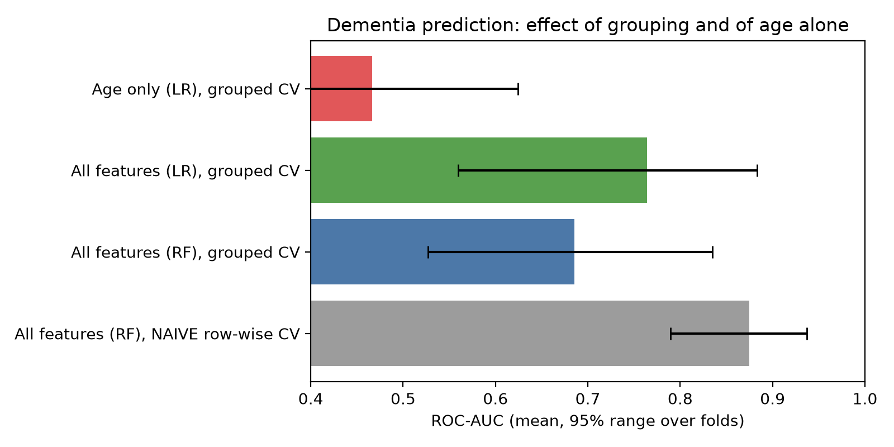
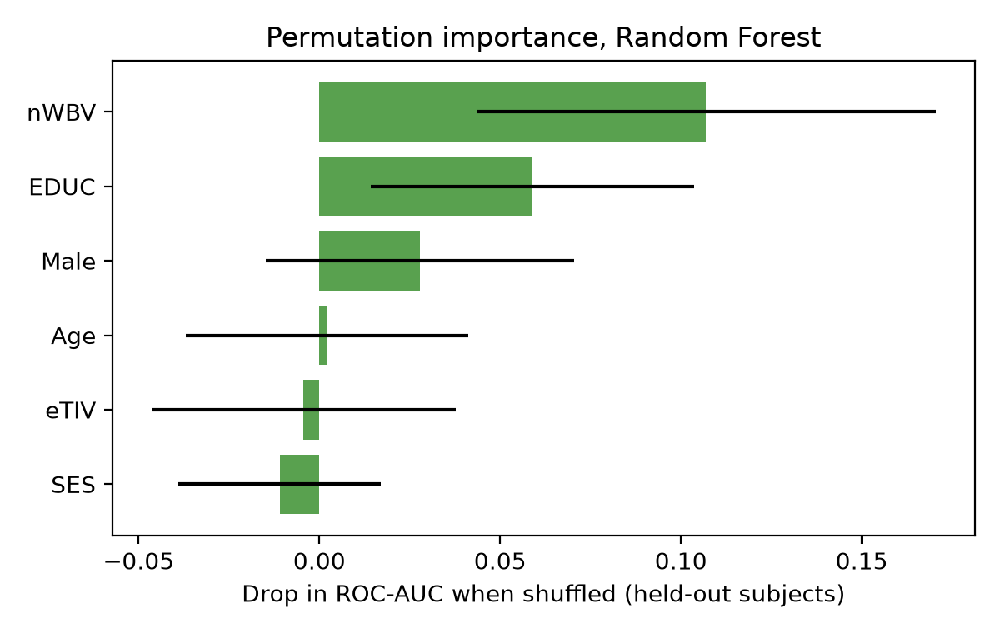
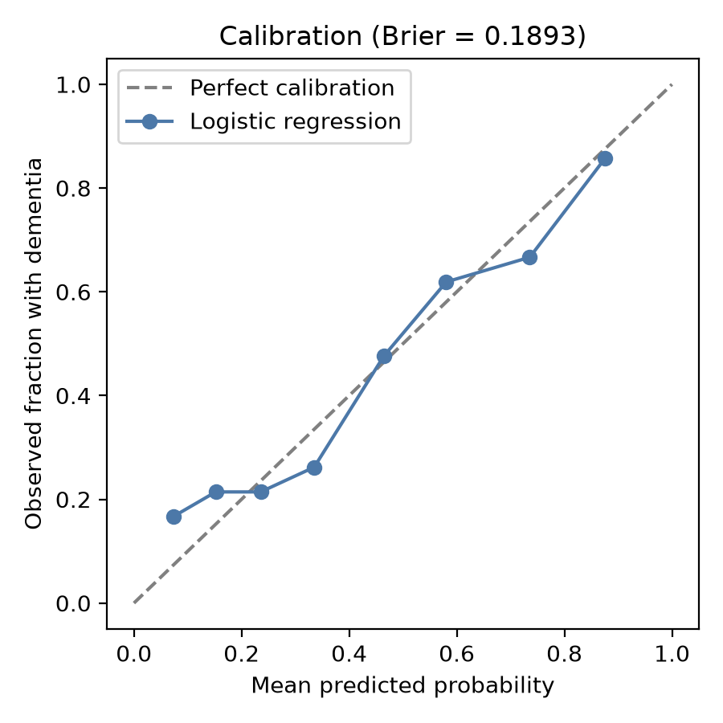
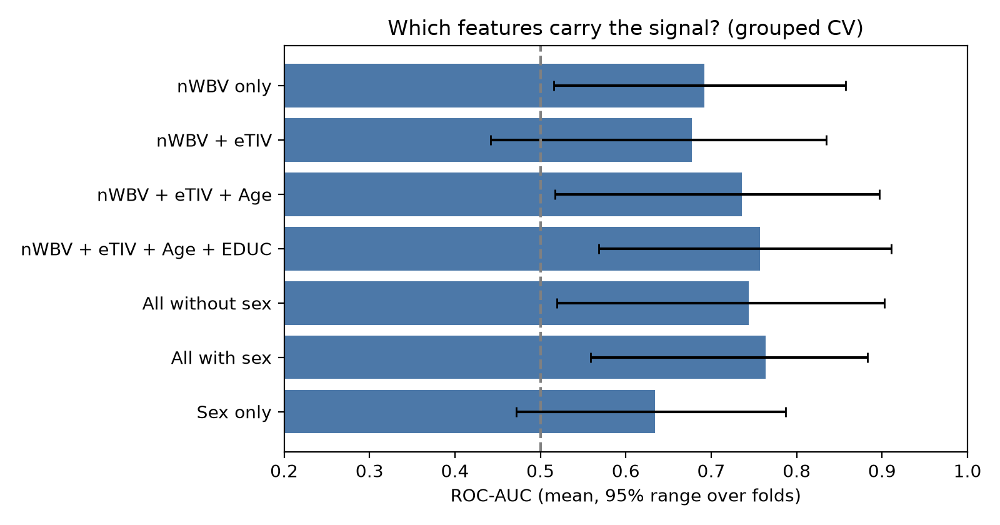

# Predicting dementia from demographic and MRI measures: a leakage-aware analysis of OASIS-2

Author: Syeda Sukaina Ahmed (BS Biotechnology, CUST, Islamabad)

## Question
Can simple demographic and MRI-derived measures (age, education, SES, sex, estimated total intracranial volume, normalised whole-brain volume) distinguish demented from non-demented older adults, and does brain volume add information **beyond age**?

## Data
OASIS-2 longitudinal MRI dataset (visits per subject, clinical group, MMSE, CDR, eTIV, nWBV, ASF). Download it from the official OASIS site (https://sites.wustl.edu/oasisbrains/), place it at `data/oasis_longitudinal.csv`, and follow the OASIS terms of use and citation requirements. The data file is **not** included in this repository.

## Methods
- **Grouped cross-validation by subject:** the same person never appears in both training and test folds (5x5 repeated stratified group k-fold, 25 folds in total).
- **Naive row-wise CV** is run alongside to measure how much ignoring grouping inflates performance.
- **CDR and MMSE excluded** from predictors: CDR is the rating used to define dementia, so using it would be circular. ASF excluded (a deterministic function of eTIV).
- 'Converted' subjects (all of their visits) removed to keep the label unambiguous; the code checks that every remaining subject has a single label.
- Median imputation (SES) fitted inside each fold.
- Models: logistic regression and random forest. Age-only logistic regression as baseline.
- Permutation importance on held-out subjects.

## Run
```bash
pip install -r requirements.txt
python descriptives_alz.py --csv data/oasis_longitudinal.csv
python analysis_alz.py --csv data/oasis_longitudinal.csv
python extensions_alz.py --csv data/oasis_longitudinal.csv
python ablation_alz.py --csv data/oasis_longitudinal.csv
```
Run these from the repository root. The scripts write figures and JSON summaries to `results_alz/`; the figures shown below are copies of that output. Random seeds are fixed, so the same data and library versions give the same numbers.

## Results
| Model | ROC-AUC (mean) | 95% range |
|---|---|---|
| Age only, grouped CV | 0.466 | 0.273 – 0.625 |
| All features (LR), grouped CV | 0.764 | 0.559 – 0.883 |
| All features (RF), grouped CV | 0.686 | 0.527 – 0.835 |
| All features (RF), naive row-wise CV | 0.875 | 0.789 – 0.937 |

"95% range" is the 2.5th to 97.5th percentile of the fold-level AUCs (25 folds). It describes how much the score varies between folds and is not a confidence interval.

Sample: 336 visits from 136 subjects (after removing 'Converted' subjects).







Extensions:
- First-visit-only (one row per person, logistic regression): AUC 0.745 (95% range 0.626 – 0.851).
- Full logistic model minus age-only model, same folds: mean AUC difference 0.298 (bootstrap 95% interval 0.256 – 0.339); the full model was better in all folds. The folds overlap in their training data and are not independent, so this interval is only indicative, and because age alone performs at chance here, the comparison is a weak test.
- Calibration plot above (Brier score 0.1893).

Key observations:
- Ignoring subject grouping inflates the random forest AUC from about 0.69 to 0.88, because repeated visits of the same person leak across train and test.
- Age alone does not predict dementia here (AUC about 0.47, i.e. chance), because demented and non-demented subjects have almost the same mean age at first visit (about 75 years; printed by `descriptives_alz.py`). So "beating age-only" is a weak benchmark in this cohort.
- Normalised brain volume (nWBV) is the most important feature, followed by education and sex. Sex is imbalanced between groups (56% male among demented vs 31% among non-demented subjects), so part of the signal may reflect cohort composition.
- The ranges across folds are wide (136 subjects), so differences between logistic regression and random forest are not conclusive.

### Feature ablation and sex check (`ablation_alz.py`)
Logistic regression with grouped CV on different feature sets:

| Features | ROC-AUC (mean) | 95% range |
|---|---|---|
| nWBV only | 0.692 | 0.516 – 0.857 |
| nWBV + eTIV | 0.677 | 0.442 – 0.835 |
| nWBV + eTIV + Age | 0.736 | 0.517 – 0.897 |
| nWBV + eTIV + Age + EDUC | 0.757 | 0.568 – 0.911 |
| All without sex | 0.744 | 0.519 – 0.903 |
| All with sex | 0.764 | 0.559 – 0.883 |
| Sex only | 0.634 | 0.472 – 0.787 |

Within each sex (features without sex): women 0.772 (78 subjects, range 0.530 – 0.943); men 0.652 (58 subjects, range 0.282 – 0.892).

Age alone is at chance in this cohort, but adding age to brain volume raises AUC from 0.68 to 0.74, which is consistent with the idea that brain volume has to be interpreted relative to age. Removing sex lowers the full-model AUC only slightly (0.764 to 0.744), and the women's subgroup shows a clear signal, so the sex imbalance is unlikely to explain the result on its own. The men's subgroup is small (58 subjects) and its range is very wide (down to 0.28), so the signal in men is less certain. Because there are only 136 subjects, none of these differences should be treated as conclusive.



## Limitations
- Small cohort (150 subjects in the dataset, 136 after excluding converted subjects), single study, no external validation.
- Features are single-visit summary values; this is not a longitudinal or causal analysis.
- Dementia labels come from clinical rating; MRI measures here are summary values, not images.
- Permutation importance is unreliable for correlated features.
- Ranges across folds are not confidence intervals, because the folds share training data.

## Tools
Python, pandas, NumPy, scikit-learn, Matplotlib.

## Citation
This analysis uses the OASIS-2 longitudinal MRI dataset (Open Access Series of Imaging Studies), which is not included in this repository:

Marcus DS, Fotenos AF, Csernansky JG, Morris JC, Buckner RL. Open Access Series of Imaging Studies: Longitudinal MRI Data in Nondemented and Demented Older Adults. Journal of Cognitive Neuroscience. 2010;22(12):2677-2684.

## License
MIT (see `LICENSE`).
